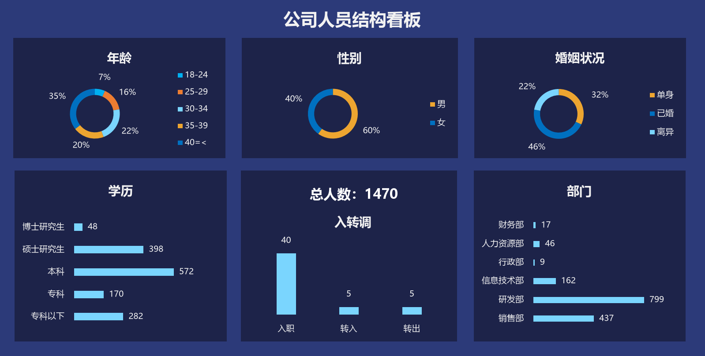

# 第四章 人力资源可视化看板 · Python / matplotlib 复刻

复刻 `第四章 人力资源可视化看板.xlsx` 右侧的「公司人员结构看板」。原表用
6 个图表对象 + 2 个文本框拼成一张 2×3 的深色看板；这里用 matplotlib 按原图
尺寸 1598 × 808 px 逐块重绘，人数从工作表的统计区域读取。



## 看板构成

| 位置 | 图表 | 类型 | 数据 |
| --- | --- | --- | --- |
| 上左 | 年龄 | 圆环图 | J11:K15 |
| 上中 | 性别 | 圆环图 | J19:K20 |
| 上右 | 婚姻状况 | 圆环图 | M11:N13 |
| 下左 | 学历 | 横向条形图 | J24:K28 |
| 下中 | 入转调 | 柱形图 + 总人数 | M17:N19、N2 |
| 下右 | 部门 | 横向条形图 | M24:N29 |

原表把统计结果放在 J/K、M/N 两列（`COUNTIFS` 公式），图表直接引用这些
单元格；脚本用 `openpyxl` 以 `data_only=True` 读取缓存值，得到同样的
97 / 229 / 325 … 与 1470 总人数。

## 样式来源

颜色和字号取自 `chartN.xml`、`drawing1.xml` 与 Excel COM 读出的形状属性：

| 元素 | 颜色 |
| --- | --- |
| 看板外框 | `#2C3A79` |
| 六个面板 / 图表区 | `#1D2349` |
| 条形图浅蓝 | `#7AD5FE` |
| 年龄分段 | `#00B0F0`、`#ED7D31`、`#7AD5FE`、`#EDA530`、`#0070C0` |
| 性别 / 婚姻 | `#EDA530`、`#0070C0`、`#7AD5FE` |

- 圆环：`holeSize = 75%`，从 12 点方向顺时针
- 标题 10pt 加粗，轴/图例 7pt，总人数 11pt，看板标题 14pt
- 横向条形图的分类顺序是 Excel 的 `maxMin` 方向，所以脚本对数据做了
  `[::-1]` 反转（博士在上、专科以下在下；财务部在上、销售部在下）

## 文件说明

```
dashboard.py             看板绘制脚本（读取统计区 + 布局 + 样式）
dashboard.png            复刻结果（1598 × 808）
compare_reference.py     与 Excel 导出图逐像素比对
export_reference.py      用 Excel COM 导出比对基准（PDF + 6 张图表）
reference/               比对基准，只在本地使用（已 gitignore）
```

## 运行

```bash
pip install matplotlib numpy pillow openpyxl
python dashboard.py

# 可选：重新导出原图并比对（需要本机装 Excel）
pip install pywin32 pymupdf
python export_reference.py
python compare_reference.py --diff
```

## 比对结果

| 指标 | 数值 |
| --- | ---: |
| 平均通道误差 | 3.28 / 255 |
| 像素一致率（RGB 差之和 < 12） | 94.38% |

## 两个实现细节

1. **怎么拿到整张看板的原图**：图表浮在单元格上，`Range.CopyPicture` 抓不到，
   导出的会是一张空白图。改用 `PageSetup.PrintArea = P1:Z25` 导出 PDF，再用
   PyMuPDF 以 200dpi 渲染，才能把 6 个图表和标题一起拍下来。
2. **字体比例**：原图里 1 Excel pt 约渲染成 2.78 px，而 matplotlib 的 1pt 是
   100/72 px，所以 `fs()` 里字号直接乘 2.0。这个系数不做的话，文字会整体
   小一圈（第一版只有参考图 72% 的大小）。
