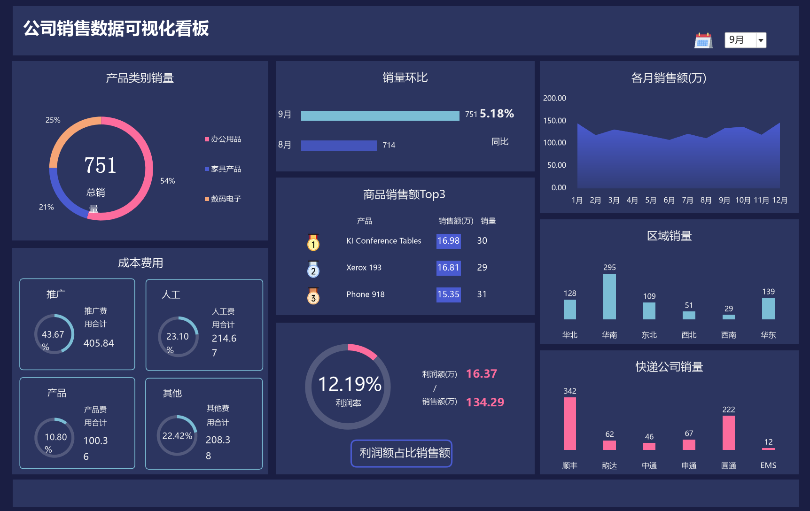

# 第四章 销售看板 · Python / matplotlib 复刻

复刻 `第四章 销售看板参考.xlsx` 的「数据大屏」工作表。原表用 11 个图表对象、
4 个成本圆环、若干矩形/文本框、一个日历图标和「月份」下拉框拼成一张
1724 × 1088 的深色看板；这里用 matplotlib 逐块重绘，所有指标都从
「销售明细」「成本明细」两张原始数据表现算，和 Excel 一样支持按月切换。



## 页面构成

| 区块 | 原图表 | 内容 | 实现 |
| --- | --- | --- | --- |
| 左侧上 | 图表 9 | 产品类别销量圆环 + 总销量 | `draw_chart9` |
| 左侧下 | 图表 1~4 | 推广/人工/产品/其他成本圆环 | `draw_kpi` |
| 中上 | 图表 7 | 本月/上月销量环比条形图 | `draw_chart7` |
| 中中 | 图表 10 | 商品销售额 Top3 表格 | `draw_chart10` |
| 中下 | 图表 11 | 利润率单值圆环 | `draw_chart11` |
| 右上 | 图表 8 | 各月销售额渐变面积图 | `draw_chart8` |
| 右中 | 图表 6 | 区域销量柱形图 | `draw_bar` |
| 右下 | 图表 5 | 快递公司销量柱形图 | `draw_bar` |
| 顶部 | 矩形 12 / 文本框 16 / 图片 17 / Drop Down 1 | 标题、日历图标、月份下拉框 | `render` |
| 底部 | 矩形 13 | 装饰条 | `render` |

## 数据口径（对应 Excel 公式）

原表「统计数据」工作表用 `COUNTIFS / SUMIFS` 现算，脚本直接从明细表做同样
的聚合：

| 指标 | Excel 公式 | 脚本 |
| --- | --- | --- |
| 月销量 | `COUNTIFS(月份_销售, D2)` | `qty[month]` |
| 月销售额 | `SUMIFS(订单额, 月份_销售, D2)/10000` | `sales[month]/1e4` |
| 月利润额 | `SUMIFS(利润额, 月份_销售, D2)/10000` | `profit[month]/1e4` |
| 区域 / 快递 / 类别销量 | `COUNTIFS(区域, …, 月份_销售, D2)` | `by_region / by_courier / by_category` |
| Top3 商品 | `RANK` + `VLOOKUP` | 按销售额排序取前 3 |
| 成本占比 | `SUMIFS(成本, 月份_成本, D2, 类别, …)` | `costs[month]` |
| 环比 | `本月/上月 - 1` | `change` |

默认月份为 **9 月**，对应原表 `统计数据!C2 = 9`。切换月份时，圆环、柱形、
Top3、成本、利润率都会重算；「各月销售额」面积图展示全年，不随下拉框变化，
这一点也和原表一致。

## 样式来源

颜色、字号、绘图区位置都不是目测：`dashboard.py` 的常量来自 `chartN.xml`、
`drawingN.xml` 和 Excel COM 读出的形状属性。

- 页面底色 `#1A1E43`，面板/图表区 `#2C3560`
- 浅蓝 `#7BBDD5`、粉 `#FC6C9D`、靛蓝 `#4A5BD1`、橙 `#F6A576`
- 圆环剩余部分 `#535A7D`（`bg1` 20% 叠在面板上）
- 标题 18pt、图表标题 12pt、轴标签 8~9pt、KPI 大数字 20/24pt
- 月环比条形图的轴按 Excel 的自动刻度还原：9 月为 680~760，对应原图
  349px / 162px 的条长

## 文件说明

```
dashboard.py                 整张看板的绘制脚本（数据 + 布局 + 样式）
dashboard.png               默认 9 月的复刻结果（1724 × 1088）
dashboard_months.gif        12 个月循环动画，演示下拉框效果
assets/                     从 xlsx 内提取的小图标（奖牌 ×3、日历）
  calendar.png
  medal_gold.png
  medal_silver.png
  medal_bronze.png
export_reference.py         可选：用 Excel COM 导出比对基准（reference/）
compare_reference.py        可选：与 Excel 导出图逐像素比对
reference/                  比对基准，只在本地使用（已 gitignore）
```

## 运行

```bash
pip install matplotlib numpy pillow openpyxl

python dashboard.py                 # 默认 9 月
python dashboard.py --month 3       # 指定 1~12 月
python dashboard.py --month 6 --out dashboard_jun.png
python dashboard.py --gif           # 生成 12 个月循环 GIF

python export_reference.py          # 重新导出 Excel 原图（需本机装 Excel）
python compare_reference.py --diff  # 与原图比对，并输出 diff/blend 图
```

## 比对结果

与 Excel 导出的看板卡片逐像素比对（`compare_reference.py`）：

| 指标 | 数值 |
| --- | ---: |
| 平均通道误差 | 5.34 / 255 |
| 像素一致率（RGB 差之和 < 12） | 91.07% |

剩余误差主要来自文字抗锯齿：Excel 用微软雅黑/宋体，matplotlib 的
FreeType 光栅化结果不同；几何位置、颜色和所有数值均已对齐。

## 两处容易踩坑的地方

1. **圆环方向**：画布 y 轴朝下，matplotlib 的 `Wedge` 角度会上下镜像。
   Excel 的 `firstSliceAng=0` 是「12 点方向、顺时针」，脚本里要把它换算成
   `-90°` 起画，否则蓝色和橙色两段会左右颠倒。
2. **文本框自动换行**：原表的百分比/金额文本框很窄，Excel 会把 `208.38`
   折成 `208.3` + `8`、把 `43.67%` 折成 `43.67` + `%`。`char_width` 用
   字宽估算来复现这个行为，四个 KPI 的折行结果才和原图一致。
